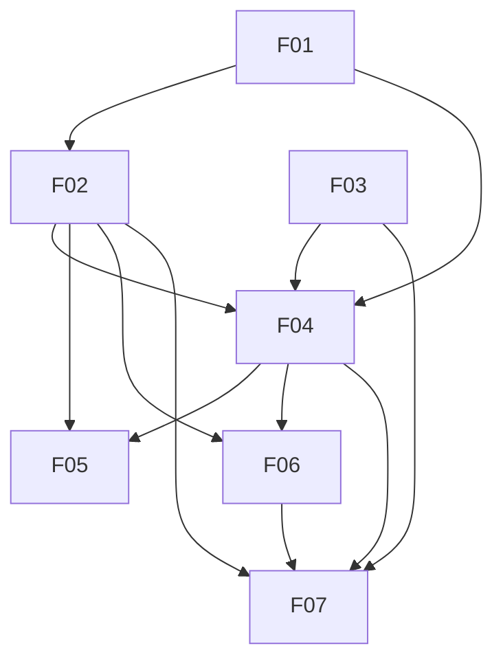

# PRD — Catraca

Ingressos para eventos pequenos. Este PRD parte do brief (R01–R13) e divide o MVP em features com dependências explícitas. O que uma feature provê precisa ser observável na feature que consome.

## Fora de escopo

- Deploy e qualquer ambiente que não seja o local.
- Gateway de pagamento real, e-mail e notificações.
- App mobile e critério visual.
- Cadastro de organizador pelo produto.
- Mais de um ingresso por compra, mapa de assentos, cancelamento ou transferência de ingresso pelo participante.
- Atualização em tempo real. Recarregar a página basta.
- Escolha de fuso pelo usuário. A interface grava horário de parede em `America/Sao_Paulo`.

## Features

### F01 Identidade

Prové: conta de participante (nome, e-mail, senha), login, logout e sessão. Papel `participant` ou `organizer`. Organizador não se cadastra aqui; a seed cria os dois organizadores e um participante.

Consome: nada.

### F02 Eventos

Prové: evento com nome, início, local, lotação e preço; nascimento em rascunho; publicar; página de gestão por URL; vitrine só com publicados não cancelados; edição bloqueada quando cancelado (o cancelamento em si é F07).

Consome: sessão de organizador da F01.

### F03 Gateway

Prové: plano do cartão de 16 dígitos. `0001` aprova em 2–4 s, `0002` recusa em 2–4 s, `0003` aprova em 33–40 s, `0004` recusa em 33–40 s, qualquer outro final recusa em 2–4 s. Cartão fora de 16 dígitos não tem plano. O modo padrão não usa chave real. Atrasos menores só existem quando `GATEWAY_*_MS` está definido, e o compose do produto não define.

Consome: nada.

### F04 Compras e vagas

Prové: compra de um ingresso pela vitrine, status inicial `pending`, código único, preço congelado na compra, ocupação de vaga até a liquidação, confirmação ou recusa pelo plano da F03, "Meus ingressos" com evento, rótulo de status e código. A vaga é contada por `src/metrics.js`.

Consome: participante da F01, evento publicado e preço/lotação da F02, plano da F03.

### F05 API de parceiros

Prové: `GET /api/partner/events`, `POST /api/partner/events/{eventId}/purchases`, `GET /api/partner/tickets/{ticketId}`, com os status HTTP e os corpos do brief. Compra de parceiro não cria conta, mas entra na mesma ocupação.

Consome: listagem de publicados da F02 e a compra/consulta da F04.

### F06 Check-in

Prové: na página de gestão, o código informado produz a primeira mensagem verdadeira da lista de R10. `checkedIn` é independente do status.

Consome: evento da F02 e ingresso da F04.

### F07 Cancelamento e painel

Prové: cancelar evento publicado, irreversível; em até 10 segundos (na prática, na mesma transação) confirmados viram `refunded` e pendentes viram `cancelled`; painel com confirmados, pendentes, check-ins, vagas, receita e estornados, nas definições de R12.

Consome: ciclo de vida da F02, liquidação da F03 (para não reverter o cancelamento), ingressos e preços da F04, check-ins da F06.

## Grafo

As setas ligam a feature que provê à feature que consome.

Arestas: F01→F02, F01→F04, F02→F04, F02→F05, F02→F06, F02→F07, F03→F04, F03→F07, F04→F05, F04→F06, F04→F07, F06→F07.

## Waves

| Wave | Features | Modo |
| --- | --- | --- |
| 1 | F01 | sequencial |
| 2 | F02, F03 | paralelo |
| 3 | F04 | sequencial |
| 4 | F05, F06 | paralelo |
| 5 | F07 | sequencial |

A wave 4 é a wave paralela integrada por PRs: cada feature na sua branch, ao mesmo tempo.

## Critérios

Cada critério cita a regra quando aplica. Critérios `CF-*` atravessam uma aresta do grafo.

### F01

- AC-F01-1. Participante cria conta com nome, e-mail e senha, entra e sai. (R13, acesso de participante)
- AC-F01-2. Organizador da seed entra. O formulário de cadastro não cria organizador. (R13)
- CF-F01-F02. Sem sessão de organizador, criar evento responde 403 e não grava evento. A sessão da F01 é o que autoriza a F02.

### F02

- AC-F02-1. Criar evento sem publicar: a vitrine e `GET /api/partner/events` não o listam. Publicar: os dois passam a listá-lo. (R02)
- AC-F02-2. Data de início no passado é rejeitada ao criar e ao editar. (R01)
- AC-F02-3. Evento guarda nome, início, local, lotação inteira ≥ 1 e preço > 0. A página de gestão tem URL própria. (R01, R04)
- CF-F02-F04. Editar a lotação para menos que as vagas ocupadas pela F04 é rejeitado; aumentar é aceito. Mudar o preço não altera o `price_cents` dos ingressos já comprados. (R03)

### F03

- AC-F03-1. Cartão que não tem 16 dígitos não gera plano e a compra não cria ingresso. (R06)
- AC-F03-2. Final `0001` aprova dentro da janela rápida; final `0002` recusa na janela rápida; `0004` ainda está pendente antes da janela lenta e fica `declined` depois dela. (R08)
- CF-F03-F04. A resposta HTTP da compra da F04 volta `pending` sem esperar o plano; o status muda sozinho quando o prazo do plano chega.

### F04

- AC-F04-1. Compra na vitrine nasce `pending`, ocupa vaga, e com final `0001` fica confirmada dentro da janela rápida. "Meus ingressos" mostra evento, rótulo e código. (R05, R06, R08, R09)
- AC-F04-2. Recusa libera a vaga. Sem vaga, a vitrine mostra "Ingressos esgotados" e a compra não insere ingresso. (R05, R07, R08)
- AC-F04-3. Em evento de lotação 5, 30 compras simultâneas resultam em 5 respostas 202 e 25 respostas 409, e a tabela fica com 5 ingressos. Vale em mais de um evento. (R07)
- CF-F04-F01. O ingresso comprado na vitrine aparece só na conta do participante que comprou.
- CF-F04-F02. Compra de rascunho ou evento cancelado não cria ingresso. A vaga usa a lotação publicada pela F02.

### F05

- AC-F05-1. Sem chave ou com chave inválida, as três rotas respondem 401 `{"error":"unauthorized"}`.
- AC-F05-2. Corpo inválido (campo faltando, e-mail mal formado ou cartão sem 16 dígitos) responde 422 `invalid_request` mesmo se o evento não existe. Evento inexistente, rascunho ou cancelado responde 404 `event_not_available`. Sem vaga, 409 `sold_out`. Ingresso inexistente, 404 `ticket_not_found`.
- AC-F05-3. A listagem traz `id`, `name`, `startsAt`, `priceCents` e `availableSeats`. A compra responde 202 com `ticketId`, `code` e `status: pending`. A consulta traz `ticketId`, `code`, `eventId`, `status` e `checkedIn`.
- CF-F05-F02. `availableSeats` e a presença na lista são os do evento publicado da F02, com a conta de vagas de R05. (R02, R05)
- CF-F05-F04. Compra pela API ocupa vaga, entra no painel, aceita check-in e sofre cancelamento como a da vitrine. (R05, R06, R12)

### F06

- AC-F06-1. As mensagens, nesta ordem, são exatamente: "Ingresso inválido para este evento", "Evento cancelado", "Ingresso não confirmado", "Ingresso já utilizado", "Entrada liberada". (R10)
- AC-F06-2. A primeira entrada válida marca `checkedIn` e o painel passa a contar esse check-in. A segunda não entra de novo. (R10, R12)
- CF-F06-F04. Código de ingresso `declined` da F04 responde "Ingresso não confirmado" e não marca `checkedIn`. Código de outro evento responde "Ingresso inválido para este evento".
- CF-F06-F02. Em evento cancelado pela gestão, o código de um ingresso daquele evento responde "Evento cancelado".

### F07

- AC-F07-1. Cancelar publicado tira o evento da vitrine e da API, a compra responde 404 `event_not_available`, e a página não oferece edição nem republicação. (R11)
- AC-F07-2. Em até 10 segundos, confirmados estão `refunded` e pendentes `cancelled`. Depois da janela lenta do gateway, continuam assim. (R11)
- AC-F07-3. O painel usa as definições de R12: confirmados incluem quem já fez check-in; receita soma o preço de cada confirmado; vagas seguem R05 e são zero se o evento está cancelado; estornados não entram na receita. (R03, R05, R12)
- CF-F07-F04. O preço usado na receita é o gravado na compra da F04, não o preço atual do evento.
- CF-F07-F03. A liquidação tardia da F03 não tira o ingresso de `cancelled` nem de `refunded`.
- CF-F07-F06. Check-in feito antes do cancelamento deixa de contar em "Check-ins" quando o ingresso deixa de estar `confirmed`. (R12)
- CF-F07-F02. O evento cancelado some da vitrine da F02 e a URL de gestão continua do organizador dono, sem voltar a rascunho.

### Acesso que atravessa a área do organizador

- AC-F02-4. Organizador B não vê o evento de A na lista nem na URL direta. Participante e visitante não recebem nome, números nem ingressos dessa URL. (R13)

## Rastreio das regras

| Regra | Critérios |
| --- | --- |
| R01 | AC-F02-2, AC-F02-3 |
| R02 | AC-F02-1, CF-F05-F02 |
| R03 | CF-F02-F04, AC-F07-3, CF-F07-F04 |
| R04 | AC-F02-3 |
| R05 | AC-F04-1, AC-F04-2, CF-F05-F02, CF-F05-F04, AC-F07-3 |
| R06 | AC-F03-1, AC-F04-1, CF-F05-F04 |
| R07 | AC-F04-2, AC-F04-3 |
| R08 | AC-F03-2, AC-F04-1, AC-F04-2 |
| R09 | AC-F04-1 |
| R10 | AC-F06-1, AC-F06-2 |
| R11 | AC-F07-1, AC-F07-2, CF-F07-F03 |
| R12 | AC-F06-2, CF-F05-F04, AC-F07-3, CF-F07-F06 |
| R13 | AC-F01-1, AC-F01-2, AC-F02-4 |
